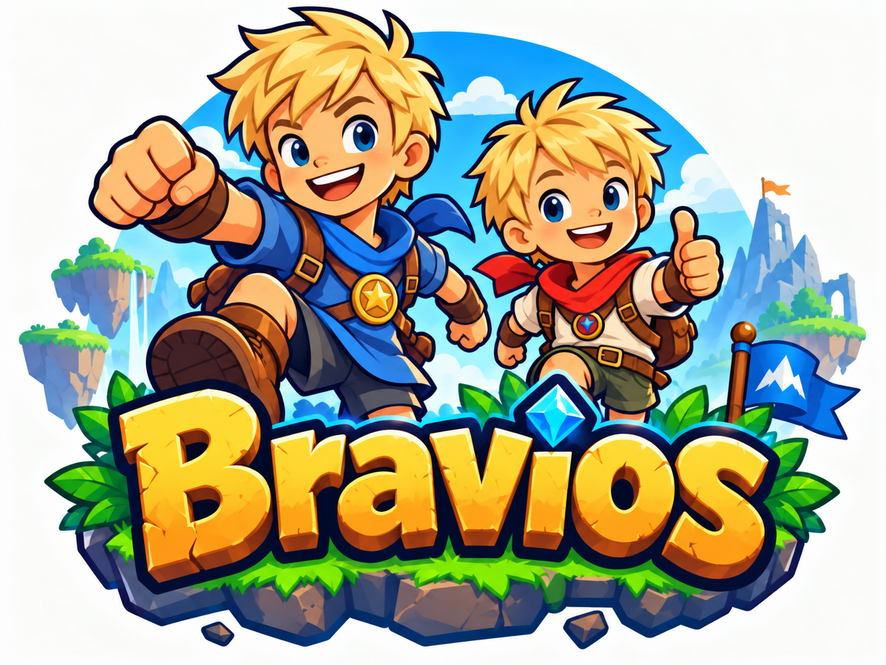

# Bravios — spelen, bouwen en leren programmeren



Bravios is een Nederlandstalige 2D-platformgame met een levelbouwer. Bouw een parcours, verzamel muntjes, ontwijk vijanden en haal de finish. Je kunt ook eigen werelden en personages maken en campagnes en kleine games spelen.

Voor eerstejaars studenten mbo niveau 4 Software Development: begin bij de [studentenhandleiding](docs/student/README.md). Daar vind je installatie, starten en een eerste uitleg van de broncode.

## Waar werk je als student?

Begin bij [gameplay](public_html/gameplay/README.md). De projectindeling is:

```text
bravios/
  public_html/
    index.html
    engine/            ← spelcode, opmaak en tests
    gameplay/          ← bewerkbare spelonderdelen
      characters/
      enemies/
      platforms/
      obstacles/
      powerups/
      interactables/
    assets/
      backgrounds/
      scenery/
      effects/
      music/
      sounds/
    speel.html         ← gegenereerde offlineversie
```

Voor tekeningen en bestaande eigenschappen werk je in `public_html/gameplay/`; achtergronden, decor en audio staan onder `public_html/assets/`. Voor nieuwe spelregels werk je, samen met je docent, in [engine/](public_html/engine/README.md). Startcommando’s voer je altijd uit vanuit de projectmap met `package.json`. De webserver blijft `public_html/` aanbieden.

## Lokaal starten

Op Windows kun je dubbelklikken op **`start-server.bat`**. Dit kiest automatisch PHP, Python of Node.js, afhankelijk van wat geïnstalleerd is.

Of open een terminal in de projectmap en kies één van deze commando’s:

| Omgeving | Commando |
| --- | --- |
| Python 3 | `python server/server.py` (op macOS/Linux meestal `python3`) |
| PHP 8.1+ | `php server/server.php` |
| Node.js 18+ | `node server/server.js` of `npm start` |

Eén van deze omgevingen is voldoende. Extra pakketten installeren is niet nodig. Open **http://localhost:8080** en stop met Ctrl+C. Samenspel vereist de PHP-server. Zie de [installatie-instructies](docs/student/installatie/README.md) en de [startinstructies](docs/student/starten.md) voor hulp.

## Documentatie

- [Structuren aanpassen](public_html/gameplay/STRUCTURES.md): bouwblokken, buizen, mechanismen en hun JSON/PNG-bestanden.
- [Vijanden en bazen aanpassen](public_html/gameplay/enemies/README.md): eigenschappen in JSON en animaties in PNG.
- [Studentenhandleiding](docs/student/README.md): installatie, starten, broncode en werking.
- [Uitgebreide spelhandleiding](docs/student/spelhandleiding.md): bediening, bouwen en spelmogelijkheden.
- [Technische architectuur](docs/other/architecture/architectuur.md): modules, opslag en resources.
- [Technische installatie en commando’s](docs/other/installation/README.md): servers, offlinebuild en tests.
- [Deployen naar devroc.nl](docs/other/installation/devroc.md): uitrollen via `roc-deploy`, serverinstellingen en de GitHub-webhook.
- [Werken met code-assistenten](docs/other/agents/README.md): wegwijzer voor ontwikkelwerk.
- [Documentatieoverzicht](docs/README.md): indeling van alle documentatie.
- [Archief](docs/archive/README.md): eerdere ontwikkelrapporten, metingen en opdrachten.


## Handleidingen bij de spelonderdelen

Studenten kunnen beginnen bij [de gameplay](public_html/gameplay/README.md). Elke onderdeelcategorie, concrete karakter-/vijand-/baas-/structuurmap en afbeeldingsmap bevat een Nederlandse README met toevoegstappen, instellingen, registratie en controles. Voor kleine games, wereldkaarten en gedeelde afbeeldingen staat ook aangegeven welke code naast een map of JSON-bestand nodig is.
