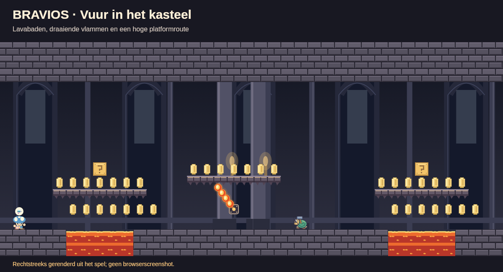

# Lava en vuurmolens in de kastelen

De vier kastelen van **De avonturiers** (velden 3, 6, 11 en 12) hebben lavabaden van vijf of zes vakjes breed en twee vakjes diep. Spring via de stenen platforms over de baden. Bij iedere tweede oversteek staat een vuurmolen: vier vlammen draaien in zes seconden volledig rond een vast anker. Je kunt onderlangs op een opening wachten of via het hogere platform oversteken. De eindbaaszalen houden een vrije stenen vloer.

Open na `npm start` de [kasteelproef](http://localhost:8080/tests/castle-fire.html). Kies een kasteel en schuif door het veld, of klik op **Spelen vanaf de start**. Loop met de pijltjestoetsen, spring met spatie en schiet met F. De proef bevat ook de echte monsters en eindbaas.

## Zelf bouwen

Kies **Mechanieken → Vuurmolen**. Houd rondom het anker drie vakjes vrij. De gestippelde cirkel in de bouwer toont het bereik. Geef de speler een veilige wachtplek buiten die cirkel en bij voorkeur een hoger platform. Het anker is geen platform; de vier oranje vlammen doen schade volgens de bestaande schild- en sterregels. Lava blijft ook met een gewone ster gevaarlijk.

## Werking en controles

- `firebars.mjs` definieert tegel 101, de ankers, draaiing, ronde trefzones en tekening. `createGame` indexeert de ankers eenmaal. Er is geen zoektocht door het hele veld per simulatiestap.
- Tekenen en botsingen gebruiken dezelfde `game.time`. Pauze stopt de molen. **Minder beweging** vermindert de decoratieve gloed; de gevaarlijke vlammen blijven op hun echte positie draaien.
- JSON-levels, PHP-kamers, samenspelsnapshots en grotreizen bewaren de ankers. Beide spelers zien dezelfde stand; samenspelen verdubbelt de draaisnelheid niet.
- `adventurers.mjs` plaatst baden en molens. `art.mjs` tekent aaneengesloten kasteellava en stenen platforms. De module staat in de lokale server en offlinebuild.

Op 7 november 2026 slaagden **371 JavaScript-tests en 116 PHP-kamertests** via `npm test`, plus PHP-lint en `npm run build`. De gerichte vuurtests controleren botsingen, schade, draaiing, beide spelers, opslag, grotreizen, de vrije eindzaal en de overeenkomst tussen zichtbare vlammen en trefzones. De routeproef haalt alle vier de kastelen met gewone sprongen en actieve lava en vuurmolens; vijanden worden voor die afzonderlijke routecontrole weggelaten. De bestaande baasgevechttests slagen ook.

Het beeld hierboven is rechtstreeks uit de tekenmodule gerenderd en visueel bekeken. De browserbediening liep vast bij navigatie; de interactieve browsercontrole van de bouwer, kasteelproef en offlineversie staat nog open. De lokale HTTP-route voor de nieuwe module is wel gecontroleerd.
