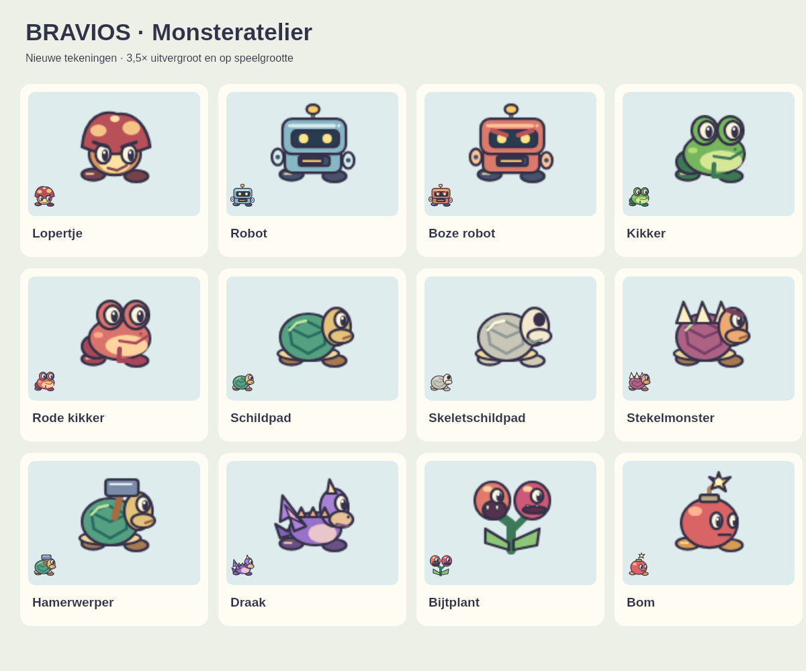

# Uitgewerkte monsters

De gewone vijanden hebben ronde vormen, donkere contouren, lichtaccenten en eigen gezichten. Dezelfde tekeningen worden gebruikt in het bouwpalet en tijdens het spelen. Bekijk het [statische overzicht](monsters-preview.png) of open na `npm start` het [Monsteratelier](http://localhost:8080/tests/monsters.html).

De reeks bevat het lopertje, de gewone en boze robot, de groene en rode kikker, schildpad, skeletschildpad, stekelmonster, hamerwerper, draak, bijtplant en bom. De schildpad houdt zijn ingetrokken houding; het skelet valt uiteen in botten. Het robotpaneel volgt de lading, de plant wisselt zijn bijtende kop af en de bom toont een brandende lont. Lopen en vleugels gebruiken acht houdingen. De bestaande kasteelbazen, Wonderland-figuren en onderwaterdieren hebben hun eigen tekenmodules.

## Code en prestaties

De originele tekeningen staan in [monster-art.mjs](../public_html/monster-art.mjs). Er zijn geen nieuwe externe afbeeldingen of beeldverzoeken nodig. `art.mjs` roept deze module aan via de bestaande tekenfuncties. Botsingen, gedrag, levelgegevens en de vijandeditor behouden hun bestaande contracten.

Elke houding wordt eenmalig getekend op een transparant oppervlak van 96 × 96 pixels: een vak van 48 × 48 op dubbele resolutie, inclusief marge rond de bestaande tekening van 32 × 32. Links en rechts gebruiken dezelfde sprite, gespiegeld tijdens het tekenen. De cache heeft maximaal 512 houdingen (18 MiB ruwe RGBA-pixels, exclusief browseroverhead). Dit beperkt herhaald tekenwerk; de daadwerkelijke FPS moet in de betrokken browser en het betrokken veld worden gemeten.

Bevriezing en de instelling voor minder beweging zetten de extra animatietijd stil. Het lopertje gaat buiten de oude statische tegelcache om, zodat zijn loopbeweging zichtbaar blijft. De bestaande lagen voor hoeden, vleugels en samengestelde vijanden blijven om de basistekening heen staan.

## Controleren

`node public_html/tests/monster-art.test.mjs` controleert tekenstatus, eindige coordinaten, bijzondere houdingen, bestaande tekenfuncties, ongewijzigde invoer en hergebruik van een sprite bij omkeren. Deze tests staan ook in `npm test`.

Het Monsteratelier toont veertien voorbeelden, inclusief twee bijzondere houdingen. Zet animatie uit, wissel kijkrichting en achtergrond, en probeer daarna het speelveld met pijltjestoetsen, spatie en F. R herstart de proef. Controleer daarnaast het normale bouwpalet en de opnieuw gebouwde `speel.html`.

De PNG hierboven is rechtstreeks met de tekenmodule gerenderd en visueel bekeken; het is geen browserscreenshot. De browserbediening gaf tijdens deze uitvoering een technische fout voor zowel navigatie als DOM-bediening. Een interactieve controle van het atelier, bouwpalet en de offlineversie staat daarom nog open.

Op 7 november 2026 slaagden 364 JavaScript-tests en 114 PHP-kamertests. De volledige opdracht `npm test` werd na 40 van de 41 JavaScript-bestanden beëindigd met exitcode 143; het resterende `crazy.test.mjs` en `rooms.test.php` zijn daarna afzonderlijk met succes afgerond. PHP-lint en de offlinebuild slaagden. De lokale HTTP-server leverde zowel de nieuwe tekenmodule als het atelier identiek aan de bronbestanden.
